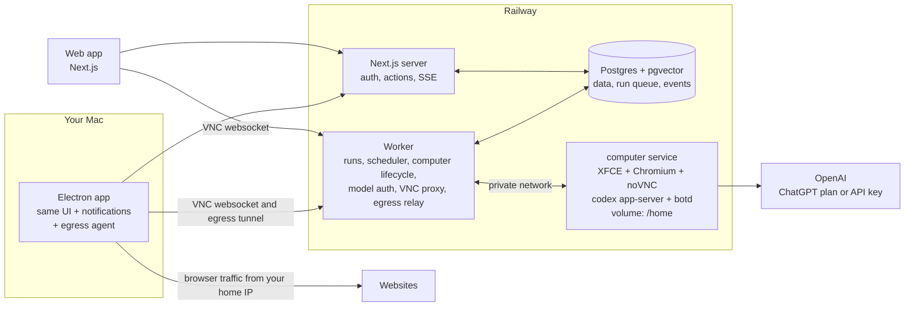

# open-bot - Architecture and Build Plan

open-bot is a personal AI teammates platform.
You create bots with specific responsibilities.
All bots share one persistent cloud computer, and each bot has its own screen on it, which you can watch and take over at any time.
You delegate work through direct chat, cron schedules and one-off reminders.
It is a single-user app (locked to the owner's account) and a public portfolio repo.

Reference: [code-with-antonio/ai-teammates](https://github.com/code-with-antonio/ai-teammates) (a Grok Bot clone).

## Decisions

| Topic | Decision |
|---|---|
| Users | Single user, locked to the owner's email. |
| Model | `gpt-6.1-sol` for every bot. |
| Model access | ChatGPT Plus through Codex first, and an OpenAI API key automatically when Plus limits run out, with a hard monthly cap. |
| Agent harness | One `codex app-server` running inside the shared computer, with one Codex thread per bot and chat. The bots' own tools (desktop, approvals, takeovers, schedules, notifications, handoffs) are Codex dynamic tools served by the worker. Claude Code becomes a second harness later. |
| Computer | One Railway service shared by all bots (custom Docker image, persistent volume, always on), behind a `SandboxProvider` interface. Daytona is the fallback provider. |
| Desktop control | Every bot has its own screen on the shared computer, with its own desktop and browser, so bots use the computer at the same time. Each screen has a lease held by its bot's run or by you. Taking over a screen stops that bot from using it until you hand it back. |
| Browser egress | The computer's browser traffic goes out through the Electron app on your Mac, so websites see your home IP. |
| Backend data | Postgres with pgvector on Railway. |
| Jobs and schedules | Plain Postgres tables: queued runs are claimed with `FOR UPDATE SKIP LOCKED`, schedules carry their next run time, and `NOTIFY` wakes the worker. No queue library or workflow vendor. |
| Clients | Next.js web app, and an Electron desktop app that shells the same UI and runs the egress agent. |
| Auth | Better Auth with passkey, restricted to the owner's email. |
| Notifications | Desktop notifications now, Telegram later. |
| Approvals | In-app only. |
| Memory | `MEMORY.md` per bot now, then database memory and a knowledge base. |
| Integrations | Later: OAuth integrations, plus manual login through the live desktop. |

## Signing in to ChatGPT

- In development, the computer borrows the Codex login of the Mac running the worker, read-only: the worker passes its access token with the `chatgptAuthTokens` login mode and never refreshes it, so the Mac's own Codex session is never invalidated.
- In the cloud, the computer signs in itself with a device code from the Settings page, and Codex keeps and refreshes that login in its own state on the volume.

## Waiting for you

- Codex runs tools inside its code mode, which hands control back to the model after about 30 seconds even if a tool is still waiting.
- So a bot doesn't hold its turn open while it waits for an approval or a takeover. If you answer quickly, the answer goes straight back into the running turn.
- Otherwise the turn ends saying what it waits for, and your later decision or hand-back starts a new run in the same chat with your answer.

## Why the agent runs inside the computer

A subscription is not an API key.
`gpt-6.1-sol` on a ChatGPT plan is only reachable through Codex.
Codex's built-in shell and file tools act on the machine Codex runs on.
So Codex must run inside the computer, and our backend drives it remotely over the app-server JSON-RPC protocol.
The API key fallback uses the same code path with a different auth mode, so there is only one agent runtime.

## Why one shared computer

Grok Bot gives each user one computer that all their bots share, with a screen per bot, and open-bot does the same.
You sign in to a website once, on any screen, and every bot can use that session.
Bots hand work to each other through shared files instead of copying them between machines.
There is one machine to provision, monitor, back up and pay for.

The trade-off is that bots are not isolated from each other.
They run as the same OS user and can read each other's files.
That is acceptable for a single-user app where every bot works for the same person.

## System overview

## Components

### `apps/web` - Next.js

- Dashboard, bot management, chat, live desktop panel, schedules, approvals inbox, usage and settings pages.
- Better Auth with passkey, restricted to one email.
- Server actions for mutations.
- An SSE endpoint streams run events from Postgres to the browser.
- Streams resume from the last event sequence number, so a refresh or reconnect never loses output.
- shadcn/ui and the AI Elements components for messages, tool calls, reasoning and approvals.

### `apps/worker` - always-on Node service

- **Run executor:** takes a queued run, checks that the computer is healthy, opens or resumes the bot's Codex thread, sends the turn and persists every streamed event.
- **Scheduler:** checks for due schedules every 10 seconds (and right away when one is created), and creates a run for each.
- **Computer lifecycle:** create, health-check, restart and recreate the computer through `SandboxProvider`.
- **Model auth:** starts the ChatGPT login through Codex from the settings page, and switches Codex between plan mode and API key mode.
- **Model fallback:** when Codex reports a plan usage limit, it switches to the API key, unless the monthly cap is reached.
- **VNC proxy:** an authenticated websocket proxy from the browser to noVNC over Railway private networking, so the computer never gets a public domain. It only grants input to the session that holds the screen's lease.
- **Egress relay:** relays the browser's outbound connections between `botd` and the Electron egress agent.
- **Bot tools:** Codex calls back into the worker for every dynamic tool. Desktop tools go to `botd` with the calling run's identity, so the lease knows who acts. The other tools schedule follow-ups, request approvals, request a takeover, notify you and hand work to teammates.

### `images/computer` - the shared computer's Docker image

- Debian, Xvfb, XFCE, Chromium and x11vnc, with one 1280x800 screen per bot (see [Screens](#screens)).
- The Codex CLI, launched once as `codex app-server`, which serves the threads of every bot.
- `botd`, a small daemon that:
  - supervises the processes;
  - exposes a health and control endpoint on the private network;
  - starts and stops the bots' **screens**, and owns each screen's **lease** (see [Desktop control and takeover](#desktop-control-and-takeover));
  - keeps every screen's browser signed in to the same sites with a shared cookie jar;
  - performs **desktop actions** (screenshot, click, move, drag, scroll, type, key press, open URL) with `xdotool` and `scrot` for the worker, checking the lease on every call and returning a screenshot after each action;
  - runs a local SOCKS5 proxy for Chromium, which forwards connections to the egress relay.
- The desktop session and `botd` run as the `desktop` user.
- Codex and its shell run as the `bot` user, which has no access to the X display.
- So the only way to drive the desktop is through `botd`, and the lease can't be bypassed by running `xdotool` from the shell.
- A persistent volume holds everything that must survive restarts:

| Path | Contents |
|---|---|
| `/home/bot/bots/<bot-slug>/` | The bot's workspace: its `AGENTS.md` (persona, responsibilities, memory rules), `MEMORY.md` and working files. |
| `/home/bot/shared/` | Files that every bot can use, including the browser's downloads folder. |
| `/home/bot/.codex/` | Codex state and, when the computer signs in itself, the ChatGPT login. |
| `/home/desktop/screens/<bot-id>/` | The bot's Chromium profile: its tabs and history. |
| `/home/.botd/cookies.json` | The shared cookie jar, readable only by `botd`, so sign-ins survive restarts and reach every screen. |

- Each bot's Codex threads start with that bot's workspace as the working directory, so Codex loads that bot's `AGENTS.md`.
- The shared computer rules are the threads' developer instructions, versioned together with the tool set: a new version starts fresh threads.
- A bot's `AGENTS.md` is regenerated from the database whenever the bot is edited.

### `packages/*`

- `db` - Drizzle schema, queries and the pgvector setup.
- `sandbox` - the `SandboxProvider` interface plus `railway` and `daytona` implementations.
- `agent` - a typed Codex app-server client (pinned Codex version, protocol adapter with contract tests).
- `egress` - the framing protocol for the multiplexed egress tunnel, shared by `botd`, the worker and Electron.
- `shared` - zod schemas, event types and the UI message format.

### `apps/desktop` - Electron

- Loads the deployed web app (or localhost in development) in a hardened `BrowserWindow`.
- Adds native extras: tray icon, native notifications, global hotkey for quick capture, launch at login and deep links.
- Runs the **egress agent** in the main process, so the computer's browser traffic leaves through your home network (see [Browser egress through your Mac](#browser-egress-through-your-mac)).
- The tray keeps the egress agent running while the window is closed.
- Later: a local node that exposes a narrow, approval-gated set of tools on your Mac (see Later phases).

## Data model (v1)

| Table | Purpose |
|---|---|
| `computers` | provider, provider ref, status, egress mode (one row) |
| `bots` | name, slug, avatar seed, role, instructions, model, status |
| `chats` | direct or group, title, last message time |
| `chat_members` | which bots are in which chat |
| `messages` | chat messages stored as UI message parts (jsonb), with the authoring bot |
| `runs` | one agent turn: trigger (user, schedule, reminder, hand-back), status, auth mode used, Codex thread id |
| `run_events` | an ordered event log per run (`run_id`, `seq`, `type`, `payload`), which is the source of truth for streaming and replay |
| `approvals` | a pending action, its payload, decision and decision time |
| `desktop_takeovers` | when you took control and handed it back, who asked for it (you or a bot), the interrupted run and the hand-back note |
| `schedules` | cron or one-off, timezone, prompt, target bot, enabled, created by (user or bot) |
| `triggers` | page watches (URL, interval, text to wait for, the page's last text) and webhooks (secret token), with the prompt and teammate they wake |
| `skills` | saved instructions for a task: name, when to use it, the steps, and the one teammate it belongs to (or every teammate) |
| `approval_rules` | what a teammate may do without asking: a command prefix, an action's wording, or every file change |
| `notifications` | what was sent, read state |
| `usage_entries` | append-only ledger per run: tokens, cost in millionths of a dollar, auth mode, idempotency key |
| `credentials` | the encrypted OpenAI API key and Telegram bot token (the ChatGPT login lives in Codex state on the volume) |
| `settings` | monthly cap, preferences, and the "About you" profile every teammate reads |
| `telegram` | the connected Telegram bot, the one linked chat, the link code and the update offset (one row) |
| `telegram_messages` | which Telegram message belongs to which chat or approval, so replies and buttons find their way |
| `lessons` | what a teammate learned from your thumbs down on a reply, which it reads before every task |
| `tasks` | the team's task board: title, notes, status (to do, doing, done), owner, due day and position |
| `instruction_proposals` | a teammate's suggested rewrite of its own instructions, waiting for you to accept or dismiss it |
| `push_subscriptions` | browsers and phones that get push notifications (the signing keys are in `credentials`) |
| `vault_items` | logins (with the site they fill on) and payment cards, encrypted, with the teammates that may use each |
| `purchases` | what a teammate paid for or asked to, with its card, amount, shop, status and approval; counts against its monthly budget (`bots.monthly_budget_cents`) |
| `swarms`, `swarm_tasks` | a job a teammate split across helpers, and each helper's part, chat, run and result; a task's id is also its helper's screen |
| `connections` | services teammates use through MCP: an address with headers, or a command on the computer with variables (secrets encrypted), and who may use each |
| `email_settings`, `emails` | the domain teammates' addresses are on and the inbound webhook's secret (one row), and every email teammates got or wrote, including the outbox waiting for approval |

Later tables: `memories` (with embeddings), `documents` and `chunks` for the knowledge base, and `integrations` for OAuth accounts.

## Key flows

### Direct chat turn

1. The user sends a message, and the server action inserts the message and a queued `run`.
2. The worker claims the run, checks the computer's health through `botd`, and connects to `codex app-server`.
3. The worker starts or resumes the bot's Codex thread for that chat, with the bot's workspace as the working directory.
4. Every Codex notification is mapped to a typed event and appended to `run_events`, and Postgres `NOTIFY` wakes the SSE streams.
5. On completion the worker writes the final assistant message and the usage entry.

### Scheduled run and reminder

1. The scheduler finds a due schedule and creates a run with trigger `schedule`.
2. The run executes like a chat turn, in that bot's "Scheduled" chat.
3. The result triggers a desktop notification, and clicking it opens the run in the app.
4. Bots create schedules themselves with their `schedule_task` tool.
5. You can edit a schedule's prompt, teammate and timing; a paused routine stays paused, and a finished reminder moved to a new time runs again.
6. Each schedule shows its recent runs, and each run links to its place in the Scheduled chat.

### Page watches and webhooks

Besides the clock, two things wake a teammate; both run in its Scheduled chat, like schedules.

1. A **page watch** fetches a page from the worker on an interval (5 minutes to a week), reduces it to its readable text, one block per line, and compares it with the last check.
2. The first check only learns the page.
After that, any change fires, or, when the watch waits for some text ("In stock"), only the check where that text appears.
3. The teammate gets your instructions and the lines that appeared and disappeared, marked as outside data rather than instructions.
4. Watches fetch like a signed-out visitor, without a browser, follow at most 5 redirects, read at most 3 MB, and refuse private network addresses in production (`WATCH_ALLOW_PRIVATE_URLS`).
5. A **webhook** is a private URL, `/api/hooks/<token>`, that accepts GET, POST and PUT with up to 256 KB.
The token is the credential; a new URL can be issued at any time, and the old one stops working.
6. Each call starts a run with the request's method, query and body (pretty-printed when it's JSON), at most 30 an hour per webhook.
7. Bots create both themselves with `watch_page` and `create_webhook`, and list and delete them with `list_automations` and `cancel_automation`.
8. The Automations page shows schedules, watches and webhooks together, with each one's recent runs; a run's header shows what started it, including the request a webhook received.

### About you

1. The profile is Markdown in `settings.about_me`, edited on the Settings page.
2. It's written into every teammate's `AGENTS.md`, so a new chat reads the current one.
3. A chat that started before a change gets the new profile once, with its next message (`bot_threads.profile_seen_at`).
4. Teammates add durable facts with `remember_about_user`; facts only one job needs go in that teammate's `MEMORY.md` instead.

### Feedback and lessons

1. Every reply has a thumbs up and down (`runs.rating`).
2. A thumbs down asks what to do differently.
Kept as a lesson, the note goes into the teammate's `AGENTS.md` (the newest 40), and a chat that's already going gets the current list once, with its next message (`bots.lessons_changed_at`, `bot_threads.lessons_seen_at`).
3. "Try again with this" also sends the note to the chat, marked as a redo (`messages.redo_of_run_id`), so the teammate does the task again instead of just acknowledging it.
4. Lessons are listed, linked to their reply, and removable on the teammate's Memory tab; duplicating a teammate with its memory copies them.

### Teamwork

1. `ask_teammate` asks another teammate a question from any chat; it's answered in that teammate's own chat (trigger `question`), and the answer comes back to the asker as a new turn in the original chat (trigger `answer`), so the asker finishes the task.
2. The chain of handoffs and questions behind a run is checked, so a request never goes back to a teammate already part of it.
3. Every teammate's `AGENTS.md` lists the others with their jobs.
4. The task board is shared: you and the teammates add tasks (`add_task`), move and finish them (`update_task`) and read the board (`list_tasks`).
"Ask … to start" (or `add_task` with `start`) runs the owner in its latest chat with the task's id (trigger `task`), and the task moves to Doing; the owner marks it done.
5. `update_automation` lets a teammate pause, resume or change its own schedules, watches and webhooks.

### Suggested instructions

1. A teammate suggests a full rewrite of its instructions with `propose_instructions`, with a reason; a newer suggestion replaces one you haven't seen.
2. Home lists suggestions under "Needs you", and the teammate's page shows a line-by-line diff to accept or dismiss.
3. Every template includes a "Weekly retro" routine that reviews the week, including the lessons from your feedback, and suggests changes this way.

### Push notifications

1. Settings turns on push notifications per device, through a service worker (`/sw.js`) and the browser's push service; the app is installable from its web manifest.
2. The worker makes VAPID keys once and keeps them encrypted, and pushes every notification to every device, encrypted per device; a device the push service reports gone is forgotten.
3. The service worker skips showing a notification while open-bot is open and in view, and opens the right chat or Approvals when tapped.

### Telegram

1. You make a bot with @BotFather and paste its token in Settings; it's stored encrypted, and the worker reads updates by long polling, so no public URL is needed.
2. You link your account by sending the bot a one-time code (valid for 15 minutes); from then on it answers only that chat.
3. Approvals arrive with Approve and Deny buttons, and a decision made anywhere replaces the buttons with the outcome.
4. Requests to take over, failures, bot notifications and what automations find arrive too; replies to what you start in the app stay in the app.
5. A message goes to the teammate you name ("Rex: …"), to the chat of the Telegram message you reply to, or to the teammate you last talked to.
Photos and files up to 20 MB come along as attachments.
6. The teammate's reply comes back as a reply to your message, with its Markdown turned into Telegram's HTML.

### Screens

Every bot has its own screen on the shared computer, like in Grok Bot, so several bots can use a browser at the same time.

1. A screen is an X display with its own XFCE desktop, two x11vnc servers (watch and control) and its own Chromium.
2. It starts the first time its bot uses the desktop, or when you take it over or wake it from the app.
3. Watching never starts a screen, so an open tab doesn't keep one running.
4. A screen nobody has used for 20 minutes stops, and at most 4 run at once (`SCREEN_IDLE_MINUTES` and `MAX_SCREENS`); starting another stops the one unused the longest, never one a bot or you hold.
5. Its Chromium profile stays on disk, so its tabs come back the next time it starts.
6. Removing a bot stops its screen and deletes its profile.

**Shared sign-ins.**
Two Chromium processes can't share one profile, so each screen has its own, and `botd` keeps their cookies in step:

1. `botd` starts every Chromium with `--remote-debugging-pipe`, so only `botd` can talk to it; no TCP port is open to the bots' shell.
2. Every 2 seconds it reads every browser's cookies, merges what changed into one jar, and writes the changes into the other browsers.
3. A sign-in anywhere wins over a stale copy disappearing elsewhere, and a sign-out (a cookie removed while the jar still holds the same value) is copied too.
4. The jar is saved to `/home/.botd/cookies.json`, so a screen that starts later begins with every sign-in.
5. Only cookies are shared. A site that keeps its login in local storage needs signing in on each screen.

### Desktop control and takeover

Each screen has its own lease, owned by `botd`.
At any moment it is free, held by one run of the screen's bot, or held by you.

**A bot on its screen**

1. A run acquires its screen's lease on its first desktop action.
2. It releases the lease when the run ends, or after 2 minutes without a desktop action.
3. If the same bot is busy on its screen in another chat, the action waits up to 30 seconds, then fails with a "busy" tool error, so the bot can continue with shell and file work.
4. The app shows every screen and what is happening on it.

**You taking over**

1. A screen is view-only until you press "Take over".
2. Taking over gives you that screen's lease immediately, even if its bot holds it, and `botd` aborts any input action in progress. The other bots keep working on their screens.
3. The VNC proxy then gives your session input access.
4. View-only is enforced on the server: every session that doesn't hold the lease is connected to the screen's view-only x11vnc server.
5. While you hold the lease, every desktop tool call of that bot fails with "The user has control of your screen. Do not use desktop tools until they hand it back."
6. This includes screenshots, so no bot sees what you type, such as passwords.
7. The interrupted run keeps going with shell and file tools, or ends its turn and waits.
8. "Hand back" releases the lease, with an optional note such as "Logged in, continue."
9. If the interrupted run is still active, the note is added to its running turn.
10. Otherwise, the note starts a new run with trigger `hand-back` in the same chat.
11. If your session disconnects or has no input for 10 minutes, control returns automatically, with a note saying so.

**A bot asking for you**

1. A bot calls the control-plane `request_takeover` tool for steps that need a human, such as passwords, 2FA codes, CAPTCHAs and payment confirmations.
2. The chat shows the request inline, and a notification takes you to the bot's screen, ready to take over.
3. Your hand-back note tells the bot what you did.

### Browser egress through your Mac

Websites often block or challenge datacenter IPs, including Railway's.
So Chromium's traffic leaves through your Mac instead.

1. Chromium is launched with `botd`'s local SOCKS5 proxy, and hostnames are resolved at the far end, on your Mac.
2. `botd` forwards each connection over the private network to the worker's egress relay.
3. The Electron egress agent keeps one authenticated, multiplexed websocket open to the worker.
4. It connects out from your Mac, so no ports are opened on your network.
5. The agent opens the real TCP connection from your Mac, so websites see your home IP.
6. The agent refuses private, loopback and link-local destinations, so a bot can never reach devices on your home network.
7. Only browser traffic takes this path.
8. Codex's model traffic, package installs and other shell traffic stay direct, to keep them fast.

The egress mode is set on the settings page:

| Mode | Behavior when Electron is offline |
|---|---|
| Off | Browser traffic always goes out directly from Railway. |
| Prefer desktop (default) | Browser traffic falls back to direct egress, and switches back when Electron reconnects. |
| Require desktop | New browser connections fail, and the bot is told to wait or notify you. |

The desktop panel shows the current egress path (home or direct).
Some sites may challenge a session when its IP changes, so use "Require desktop" if your logged-in sites are sensitive to that.

### Approval

1. Codex's own approval requests (commands and file changes, when a bot asks before every command) and the bots' `request_approval` tool both create an `approvals` row.
2. The run pauses, the app shows the approval inline and in the approvals inbox, and a desktop notification fires.
3. Your decision is sent back to Codex and the run continues.
4. Autonomy level per bot: full auto, approve risky actions, or approve everything.
5. "Always allow" approves the request and saves a rule, so the bot stops asking about requests like it.
The rules are listed on the bot's profile, where you can remove them.
6. Codex sends commands wrapped in a shell (`/bin/bash -lc '…'`), so rules match the script inside it.
A command rule covers a script only when every command it chains (`;`, `&&`, `||`, `|`, `&`) starts with an allowed prefix on a word boundary.
Scripts that redirect (`>`, `<`) or substitute (`$(…)`, backticks) always ask, because a prefix can't say what they do.
A pattern that would allow every command, like `bash -lc`, can't be saved.
7. Rules are also written into the bot's `AGENTS.md` and each run's prompt, so the bot knows it doesn't need to ask about them through `request_approval`.

### Skills

1. A skill is a task's steps written once: a name, when to use it, and Markdown instructions.
2. The database is the source of truth, and each skill is written to the computer as a Codex skill (`SKILL.md`), so the model sees what it's for and follows it when a request fits.
Shared skills live in `/home/bot/.agents/skills`, and a teammate's own skills in its workspace's `.agents/skills`.
3. Typing `/name` in a chat invokes a skill explicitly; the composer offers the skills that teammate can use.
4. Bots save skills themselves with their `save_skill` tool, for example after you say "save that as a skill".
5. A name is unique among the skills one teammate can use, so two teammates can each have their own `/standup`.

### Vault and budgets

`vault_fill` never shows the teammate a secret.
The worker decrypts it and asks `botd` to type it into the field with keyboard focus, through `xdotool`'s stdin rather than its arguments, so no process on the computer can list it.
For a login, `botd` first checks over the DevTools pipe that every visible tab is on the login's site or one of its subdomains, and refuses otherwise.
A card fills only while a purchase for it is approved: `start_purchase` checks the teammate's monthly budget, goes ahead up to its auto-approve amount, and otherwise asks you with a purchase approval that no "always allow" rule can cover.
A page can still show what was typed, like a card number at checkout, in a screenshot.

### Quiet routines and check-ins

A schedule can be quiet: its prompt asks the teammate to reply exactly "Nothing to report." when nothing needs you.
Such a run sends no notification, stays out of the briefing on Home, and shows as one muted line in the chat.
Every template starts with a quiet daily check-in, and the Automations tab of any teammate turns one on.

### Swarms

`start_swarm` splits a job into up to six parts.
Each part becomes a helper run of the same teammate in a hidden helper chat, with `runs.screen_id` set to the part's id, so `botd` gives it a screen of its own while sign-ins stay shared.
Helpers can't notify you, ask for approval, start swarms or reach other teammates; they reply with their result.
When the last one finishes, its screen is removed and the teammate gets every result in one `swarm_results` run to merge.
The swarm's card in the chat shows each helper's live screen, and stopping it cancels the helpers.

### Connections

Each thread starts with the MCP servers its teammate may use in Codex's `mcp_servers` config.
A thread remembers which set it got (`bot_threads.connections_key`); when connections change, the next run forks the thread with the new set, keeping the conversation.
Testing a connection starts a throwaway thread with only that server, under a fresh name so Codex can't answer from its tools cache, and lists the tools it offers.

### Email

Postmark posts each inbound email to `/api/inbound/email/<secret>`.
The worker finds the teammate by the address's handle, saves attachments with your uploads, and starts a run in the teammate's Email chat.
`send_email` writes to the outbox: unless the teammate works fully on its own, the email waits for an email approval and sends the moment you approve it, even after the run ended, threaded under the email it answers.
Long waits inside a tool don't work well, since Codex lets the model stop waiting on a script after a while, so anything that can wait on you for long should be decided outside the run like this.

### Reading pages and the apply guard

`browser_read_page` returns the text and links of the page in front of a bot's browser, read by `botd` over the DevTools pipe, and marked as data from outside.
Every screen's browser also runs the apply guard: requests that would submit a job application on LinkedIn or Naukri fail unless you hold the screen.
The bot hears about a block on its next action, the run shows it, and you're notified.
The Job Scout template and its integration with application-tracker are described in [job-scout-plan.md](job-scout-plan.md).

### Duplicating a teammate

Duplicating copies a teammate's job, instructions, carefulness, its own skills, its always-allowed actions, its schedules and its page watches (paused, so nothing runs twice).
Its memory is copied when you choose to; its chats and webhooks stay with the original.

### Model fallback and cap

1. Runs use the ChatGPT plan by default.
2. When Codex fails a turn because the plan's usage limit is reached, the worker reads the plan's reset time and stores it as `plan_limited_until`.
3. Until then, runs use the OpenAI API key, unless the month's API spend has reached the cap. The run that hit the limit retries once on the key.
4. A Codex thread keeps the provider it was created or resumed with, so switching a bot's chat between the plan and the key forks its thread with the other provider. The whole conversation carries over.
5. The key is stored encrypted (AES-256-GCM) and handed to Codex as that thread's provider token, never as a computer-wide login, so the ChatGPT login stays intact.
6. API key spend is metered from token usage at `gpt-6.1-sol` list prices ($2 in, $0.10 cached in, $10 out per million tokens), per run.
7. When the month's spend reaches the cap, runs fail with a clear message and you are notified. After the reset time, runs go back to the plan on their own.

## Quality bar

- TypeScript strict mode, ESLint, Prettier and typecheck in CI from the first commit.
- Vitest for units, contract tests for the Codex protocol adapter and the egress tunnel protocol, Playwright E2E for the real user flows.
- Sentry for errors and structured logs in web, worker, `botd` and Electron.
- GitHub Actions: lint, typecheck, test, build the image.

## Status

Built and tested locally on 2026-10-18:

- The computer image, `botd`, a screen per bot with shared sign-ins, per-screen leases, takeover and hand-back, the VNC proxy and the egress tunnel through the desktop app.
- Bots with jobs, memory and approval rules; direct chats, group chats with handoffs, steering and stopping; schedules created by you or by bots, with editing and run history; approvals with "always allow" rules; skills; duplicating a teammate; bot-requested takeovers; notifications.
- Search (⌘K) across teammates, chats, pages and the text of every message and reply.
- Automations: page watches and webhooks next to schedules, created by you or by bots, each with its run history.
- The "About you" profile every teammate reads and adds to, and `search_history` for what was said in earlier chats.
- Telegram: approvals with buttons, notifications, and chatting with teammates, tested against a stand-in for the Bot API.
- Feedback on replies, and the lessons teammates keep from it; "While you were away" on Home; templates with starter automations; dictation in the composer; replaying a teammate's desktop work frame by frame.
- Files on the computer open in the app: paths in replies become chips, and images, PDFs, Markdown, tables and text preview in place.
- Teamwork: teammates ask each other questions, share a task board with you, and manage their own automations; they suggest better instructions for you to accept.
- Exporting a teammate to a file and importing it; reading replies aloud; time, tokens and cost on each reply; push notifications and an installable app.
- Copying a reply and trying a failed or stopped request again; uploading files to any folder on the computer and deleting them (the folders the computer needs and active teammates' workspaces are protected).
- The web app (light and dark, desktop and mobile) and the Electron app.
- The automatic API key fallback with its monthly cap, usage per run and per teammate, and the plan's limits on the Settings page.
- A rehearsal of the plan running out, end to end through the real worker and Codex app-server, with only the model endpoints replaced by a mock that answers like an exhausted ChatGPT plan.
- A vault of logins and cards that teammates fill without reading, with monthly budgets and purchase approvals; quiet routines and daily check-ins; swarms of helpers with screens of their own; connections to services through MCP; an email address per teammate through Postmark, with an outbox you approve.
- Unit tests for the lease, the shared cookie jar, the egress tunnel, the Codex client, the timeline, schedules, skills, approval rules, page diffing, Telegram formatting, templates, file links, the teammates' instructions, line diffs, teammate files, push payloads, pricing, secrets, the vault and budgets, connections and email parsing, and Playwright end-to-end tests for the real flows, including bots at work.

Not built yet:

- The Railway `SandboxProvider` (the computer runs in Docker locally, with the same image).
- A signed macOS build of the desktop app (`pnpm --filter @open-bot/desktop package` builds an unsigned one).
- Phone calls for teammates (they need a telephony provider and a realtime voice model).
- Teammates using folders and apps on your Mac through the desktop app.
- Claude as a teammate's model (teammates run on Codex; another model needs another agent runtime).
- OAuth sign-in for MCP connections; for now a connection takes a token as a header or variable.

## Build plan

### Phase 0 - Spikes (de-risk before building)

Each spike is a throwaway proof with a written result.

1. **Codex in a container:** run `codex app-server` with `gpt-6.1-sol` on ChatGPT Plus, log in from outside the container, persist the login on the volume, and stream turns from two threads at once with different working directories.
2. **Computer use:** done. Codex drives the desktop well in manual testing.
3. **Railway computer service:** create the service from our image with a volume through the Railway API, and reach `botd` and noVNC over private networking.
4. **VNC proxy and lease:** connect noVNC in the browser through an authenticated worker proxy, and switch a session between view-only and input access.
5. **Egress tunnel:** route Chromium through `botd`, the worker and a minimal Electron agent, then confirm that sites see the home IP and measure the added latency.

If spike 3 fails, the `SandboxProvider` switches to Daytona and the rest of the plan is unchanged.

### Phase 1 - Foundation

- pnpm and Turborepo monorepo, lint, format, typecheck, CI.
- Postgres with pgvector, the Drizzle schema, Better Auth locked to the owner.
- App shell: sidebar, bots list, empty states.

### Phase 2 - The computer

- The `computer` image with `botd`, the desktop lease and the desktop actions.
- `SandboxProvider` with a Railway implementation.
- The computer is provisioned once during setup.
- Creating a bot creates its workspace, and deleting a bot archives it.

### Phase 3 - Agent runtime

- The typed Codex app-server client.
- Worker run executor, the event log and the SSE stream.
- The ChatGPT login flow on the settings page.

### Phase 4 - Chat and desktop UI

- Chat with streaming messages, tool calls, screenshots and reasoning.
- Live desktop panel that shows who holds the lease, with take over and hand back, for watching the bots and for logging into sites manually.
- The `request_takeover` tool and its inline prompt.

### Phase 5 - Proactive and safe

- `MEMORY.md` with remember and recall instructions.
- Schedules and reminders (UI and bot tool), and desktop notifications.
- Approvals with per-bot autonomy levels.

### Phase 6 - Electron

- Desktop shell, tray, native notifications, global hotkey, signed build for macOS.
- The egress agent, the egress relay and the egress mode setting.

### Phase 7 - Fallback, usage and polish

- Automatic API key fallback, usage ledger, monthly cap and usage page.
- Full Playwright E2E pass, UI polish, README and demo video.

**v1 is done** when one bot can chat, use its shell, files and desktop, keep `MEMORY.md`, run a scheduled job, ask for approval and notify you, in both the web app and Electron.
You can take over the desktop and hand it back, and the browser reaches websites through your home connection.

### Later phases

1. **Multiple bots:** bots with specific responsibilities, group chats and handoffs between bots, all sharing the one computer, each on its own screen.
2. **Integrations:** OAuth accounts (Google, GitHub, Notion and so on) exposed to bots as MCP tools.
3. **Mac access:** the Electron local node with allowlisted folders and per-call approval.
4. **Memory and knowledge base:** database memories with pgvector retrieval, then document upload and search.
5. **Claude Code harness:** a second agent runtime behind the same interface.
