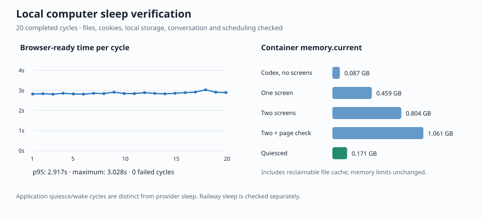

# Railway computer sleep: implementation and verification

Implemented from `4936b842dc41fef998367f9fc4407dfae832dca5` on
`feat/reduce-railway-cost`. Production was updated by Railway CLI uploads from
this worktree before opening the review PR. Nothing was merged.

## Deployed policy

| Service     | Policy                                                                        |
| ----------- | ----------------------------------------------------------------------------- |
| computer    | Lifecycle enabled; Railway Serverless enabled; one replica                    |
| worker      | Lifecycle enabled; five-minute demand grace; Serverless disabled; one replica |
| Postgres    | Serverless disabled; existing database volume retained                        |
| web / pages | Existing Serverless settings retained                                         |

Computer screens have a three-minute idle timeout and an atomic two-screen
limit, including screens that are starting. Additional screen requests wait
with cancellation and a bounded admission timeout. Page checks run one at a
time, in addition to the two screens. Memory limits were not lowered.

The existing computer volume `0489eea9-1830-4998-82c7-02a552208b7e` remains mounted
at `/home`. The Postgres volume and image were preserved. Codex version, model,
provider behavior and its refresh loop were not changed.

## Implementation

- botd exposes liveness independently of Codex readiness, plus authenticated,
  versioned, idempotent lifecycle operations and a renewable controller lease.
  Process start/stop is serialized; stale restart callbacks are fenced.
- Worker demand covers runs through preparation, model/tool waits, approvals,
  takeovers and completion, as well as explicit computer-backed HTTP operations.
  Concurrent callers share a wake. Cancelling one caller does not cancel another
  caller's wake. Admission waits for shutdown to finish before restarting compute.
- Wake tolerates initial 502s within a 120-second total deadline. It reloads saved
  routing policy and phone revocations and waits for botd's applied egress state
  before admitting browser work. User actions are not automatically retried.
- Successful quiesce flushes cookies, lets Chromium finish closing its profile,
  verifies process-group exits, stops Codex, and pauses events, Codex and computer
  egress transports. Desktop/phone agent sockets and worker scheduling continue.
- Independent botd checks refuse shutdown for active requests, turns, logins,
  downloads, leases and unregistered background jobs. A lost controller/socket or
  expired lease alone never stops compute. Unknown activity blocks sleep.
- Idle edits remain in Postgres. Workspace/skill projections, deletions and current
  configuration are reconciled before execution. Bot saves report
  `workspaceSynced: false` when deferred.
- Web/mobile status separates compute lifecycle from authentication. Intentional
  idle retains cached account state, rate-limit displays use cached data, and
  passive VNC views disconnect without waking the computer. Loaded-thread markers
  are cleared after reconnect so saved conversations are resumed.
- Synchronous client/worker timeouts cover wake plus work. Existing upload/code
  operation IDs and lost-response recovery remain in place. Code-entry quarantine,
  owner-only release guards, vault fills and application guards were preserved.

The feature defaults off for existing local development. Railway enables it on
both computer and worker using `COMPUTER_LIFECYCLE_ENABLED=true`.

## Verification

The independent computer/database tests used separate containers and storage;
the normal local compose project and its volumes were not used. Temporary local
containers, the test home volume and the isolated web/worker servers were removed.

| Check                                                                  | Result                                                                                                             |
| ---------------------------------------------------------------------- | ------------------------------------------------------------------------------------------------------------------ |
| botd tests                                                             | 58 passed                                                                                                          |
| worker unit tests                                                      | 129 passed                                                                                                         |
| worker database integration tests                                      | 90 passed                                                                                                          |
| mobile tests                                                           | 172 passed                                                                                                         |
| web unit / database integration tests                                  | 16 / 6 passed                                                                                                      |
| agent client tests                                                     | 5 passed                                                                                                           |
| Affected typechecks, repository lint, formatting and production builds | Passed                                                                                                             |
| Application quiesce/wake trial                                         | 20/20 completed; browser-ready p95 2.917 s; maximum 3.028 s                                                        |
| Follow-up resource/conversation/scheduling trial                       | Passed on the later implementation                                                                                 |
| Live provider sleep                                                    | Railway reported `sleeping` at 2026-11-07 07:03:47 UTC                                                             |
| Live cold wake                                                         | Browser ready in 6.807 s; sentinel file and ChatGPT auth preserved                                                 |
| Final uninterrupted quiet test                                         | Passed: 720 seconds with a connected test agent, cached status/rate-limit polling, no wake and no lifecycle errors |

The usual unit commands skip environment-gated database cases. Those skips were
not counted as passes: `test-bots.sh` and `test-mobile-api.sh` ran the corresponding
90 worker and 6 web database tests against disposable Postgres instances.

The cycle trial checked file contents, HttpOnly cookies, browser local storage,
account caching and disconnected computer transports. Further checks verified:

- Two leased screens remain intact when a third queued request is cancelled.
- Concurrent page checks serialize; the measured workload included two screens
  plus a headless page checker.
- A conversation resumes the same persisted Codex thread after restart, with the
  prior user message present in the next model request. Model responses were
  supplied by a local fixture, without real model generation charges.
- A one-time schedule wakes an idle computer and completes exactly once.
- Real bot and desktop background processes refuse quiesce until they exit.
- Phone/desktop relay tests preserve agent connections during computer pause and
  apply saved routing/revocations before resume.
- Authenticated headless web verification traversed setup → computer page → wake
  → working VNC canvas → idle. The canvas unmounted on sleep, account state stayed
  cached, and the mobile API contract retained an explicit wake action. No page
  errors occurred. A native mobile device was not exercised.

The live test preserved its original sentinel across multiple deployments and a
provider sleep/wake. The final quiet test ran from 07:22:31 to 07:34:31 UTC on
2026-11-07, after the last computer deployment. It used a temporary test-agent
socket because the real desktop application was no longer connected. The agent
remained attached throughout all 720 seconds, with zero routed connection frames;
cached status/rate-limit polling did not wake the computer. Railway reported the
final deployment sleeping at 07:28:17 UTC and again at 07:34:52 UTC, with worker,
Postgres, web and Pages online. No real phone was connected during the live test.

The temporary bot, sentinel file, browser profile, workspace and test-agent
connections were removed. Cleanup verification is included in the raw results.

An intermittent browser-storage flush race and a rollout-only leak of unsent
Codex initialization requests were found and corrected before the final checks.
Regression tests cover these lifecycle boundaries, reconnect failures, shared
wake cancellation, shutdown races, stale callbacks and deadline failures.



The memory chart is from the local container's cgroup counter, including
reclaimable file cache. It is not Railway billing data. Per-process RSS sums in
[the raw results](computer-sleep-results.json) also double-count shared pages.
Process counts returned to the same baseline over repeated cycles.

## Cost interpretation

Railway Serverless was already enabled on the computer before this work. Eager
Codex startup and permanent worker transports prevented it from becoming quiet.
The new lifecycle removes those sources of idle traffic and verifies provider
sleep rather than treating an Idle label as stopped compute.

A period-to-date billing baseline is saved in the raw results. It is not a
post-change savings measurement. Storage, always-on services and the workspace
plan minimum still apply; a monthly savings figure needs a later billing period
comparison.

## Reproduce and rollback

Local lifecycle tests:

```sh
SLEEP_TEST_RESOURCE_CHECKS=1 bash scripts/test-computer-sleep.sh
```

This requires the local `open-bot-computer:dev` test image. The script creates
independent computer/Postgres containers and storage, builds the changed services,
uses a disposable fake auth fixture, and removes its temporary infrastructure.
The additional web-flow script is
`apps/worker/scripts/computer-sleep-web-smoke.ts`; run it only against the isolated
localhost setup described in that script.

To restore eager startup/connections, disable `COMPUTER_LIFECYCLE_ENABLED` on both
Railway services and redeploy them during an idle window. Keep `/home` mounted.
Disable computer Serverless and redeploy if provider sleep itself must be rolled
back. Worker and Postgres can remain always on.

All commands must target project `ffe4f999-838d-41fe-b21b-1703469a7039`, environment
`52dce811-6c4d-49ab-9db9-ef29d85510aa`. The final deployment IDs and policy snapshot
are in the raw results.

These changes were uploaded to production before review and remain unmerged. A future deployment from unchanged
`main` would replace them, so review the branch before the next normal release.
